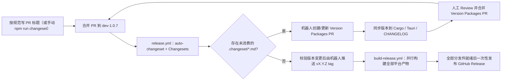

# 发版与自动打包指南

本仓库采用 **GitHub App 机器人 + Changesets** 的自动化发版体系，并在 `v*` tag 触发后统一完成全平台 Wheel 与 Windows 桌面安装包（PyInstaller + Tauri）构建，最后一次性发布包含全部产物的 GitHub Release。

## 整体流程



> **为什么需要 GitHub App Token？**
> 过去 `ci.yml` 使用默认 `GITHUB_TOKEN` 创建 Release，导致依赖 `release` 事件触发的 Windows 桌面端与 Termux 构建无法联动运行；同时 `GITHUB_TOKEN` 推送的 tag 也不会触发其他 workflow。改用 GitHub App 生成的安装令牌后，机器人开启 PR 与推送 `v*` tag 均可正常触发下游流水线。

---

## 版本号规范变更（切换至 SemVer）

- 此前测试版使用的四段式版本号（`1.0.7.001` ~ `1.0.7.009`）及对应历史 tag 保留不变。
- 从本方案上线后的下一版开始切换为标准 **SemVer**（下一版为 **`1.0.8`**，tag 为 **`v1.0.8`**）。
- 根目录 `package.json`（包名 `biliup`）作为唯一版本源，执行 `npm run version-packages` 时自动同步至：
  - `crates/stream-gears/Cargo.toml`（决定 Python wheel 版本号）
  - `tauri-app/src-tauri/Cargo.toml`、`tauri-app/src-tauri/tauri.conf.json`、`tauri-app/package.json`
  - `Cargo.lock`（`stream-gears` 与 `tauri-app`）
  - 根 `CHANGELOG.md` 与文档站 `docs/content/docs/guide/CHANGELOG.md`
  - `app/changelog.generated.json`（WebUI 首页内置更新日志数据）
- 注意：`crates/biliup` 与 `crates/biliup-cli`（`0.2.4`）保持独立版本，不受此同步脚本影响。

---

## 日常开发与发版操作

1. **平时提 PR 不用手动写 `.changeset`**：只要 PR 标题或提交信息遵循常规提交规范（Conventional Commits），合并到 `dev-1.0.7` 后机器人会自动识别：
   - `feat: ...` → 升 **minor** 版本（例如 `1.0.8` → `1.1.0`）
   - `fix: ...` / `perf: ...` / `revert: ...` → 升 **patch** 版本（例如 `1.0.8` → `1.0.9`）
   - `feat!: ...` 或提交正文含 `BREAKING CHANGE:` → 升 **major** 版本
   - `docs:` / `chore:` / `ci:` / `test:` / `style:` / `refactor:` → **不触发发版**
   - 如需自定义更详细的 Release 说明，仍可在 PR 中运行 `npm run changeset` 手动生成 `.changeset/*.md`（同一提交存在手动 changeset 时优先采用手动文件）。
2. PR 合并到 `dev-1.0.7` 后：
   - `.github/workflows/release.yml` 自动读取自上次发版 tag 以来新增的 PR 标题/提交并生成变更条目，由机器人创建或更新 `chore(release): version packages` PR。
   - 若尚未合并 `Version Packages` PR，后续继续合并的 `feat:` / `fix:` PR 会自动汇总追加到同一个 `Version Packages` PR 中。
3. 需要正式发版时，**合并 `Version Packages` PR** 到 `dev-1.0.7`：
   - `release.yml` 检测到无未消费的 changeset 且远端尚无当前版本号对应的 tag（且非基线版本），即自动打 `vX.Y.Z` tag 并推送。
4. `build-release.yml` 由 `v*` tag 触发：
   - 并行调用可复用 workflow `ci.yml` 构建全部 Linux / musllinux / Windows / macOS wheels 与 sdist，同时构建 Windows Tauri 安装包。
   - 全部核心产物就绪并通过完整性校验（至少含 `.whl`、`*-setup.exe`、`*.msi`）后，执行防篡改溯源签名（artifact attestation）并一次性发布 GitHub Release。

---

## 一次性配置清单（GitHub App 与 Secrets）

本仓库仅需配置 **GitHub App 密钥**（可与 `zhihu-backup` 共用同一个 GitHub App）：

1. 若尚未创建 GitHub App：在 GitHub **Settings → Developer settings → GitHub Apps → New GitHub App** 创建私有 App（例如 `pingshazi-release-bot`）：
   - **Webhook**：取消勾选 **Active**
   - **Repository permissions**：`Contents: Read and write`、`Pull requests: Read and write`
   - **Where can this GitHub App be installed?**：**Only on this account**
   - 创建后记录 **Client ID** 并点击 **Generate a private key** 下载 `.pem` 私钥。
2. 在 GitHub App 的 **Install App** 页面将其安装到本仓库（`pingshazikdjnd/biliup-1.0.7`）。
3. 在仓库 **Settings → Secrets and variables → Actions → Repository secrets** 添加：
   - `RELEASE_APP_CLIENT_ID`
   - `RELEASE_APP_PRIVATE_KEY`

   也可以使用 GitHub CLI 写入（注意对应仓库实际名称）：
   ```bash
   gh secret set RELEASE_APP_CLIENT_ID -R pingshazikdjnd/biliup-1.0.7 -b "<你的Client_ID>"
   gh secret set RELEASE_APP_PRIVATE_KEY -R pingshazikdjnd/biliup-1.0.7 < "<私钥.pem路径>"
   ```

---

## 变更说明与已知限制

- **旧 workflow 整合**：已将原重复的 `releases.yml` 与 `pyinstaller-publish.yml` 整合进 `.github/workflows/build-release.yml` 统一编排，并移除了不使用的 `Termux-publish.yml`；`ci.yml` 改造为可复用的纯构建 workflow（并升级至 `actions/setup-node@v4`）；保留 `Build Old Version.yml` 与 `docs-publish.yml`。
- **PR 阶段跳过打包**：`ci.yml` 已移除 `pull_request` 与分支 `push` 触发、`docker-publish.yml` 已移除 `pull_request` 触发（`docs-publish.yml` 亦仅对修改 `docs/**` 的非 `changeset-release/*` PR 运行），普通业务 PR 与 `Version Packages` PR 均不执行打包；完整全平台打包仅在合并发版 PR 推送 `v*` tag 后由 `build-release.yml` 单次触发（亦可按需手动 `workflow_dispatch` 触发）。
- **Docker 发布暂未在 tag 启用**：`.github/workflows/docker-publish.yml` 已移除 `tags: v*` 触发器，原因是其中的 `IMAGE_NAME` 仍指向上游组织镜像 `ghcr.io/biliup/caution`；如需从本 fork 发布 Docker 镜像，请先将 `IMAGE_NAME` 改为你自己的仓库路径后再恢复 tag 触发。
- **前端内置更新日志自动同步**：`npm run version-packages` 执行 `sync-version.mjs` 时会自动将新版 SemVer 变更同步至 `app/changelog.generated.json`，并在 `app/page.tsx` 中与历史 `1.0.7.001 ~ 1.0.7.009` 条目合并展示（自动将最新一条标记为 `Latest` 并跳转到 `vX.Y.Z` tag）；仅当 fork 到其他仓库时需按需调整 `REPO_RELEASES_URL`。

---

## 常见异常与恢复

- **`build-release.yml` 构建或发布中断**：
  可在失败的 workflow 运行页点击 **Re-run failed jobs**，或手动触发 `Build and Release` workflow 并选择对应的 `vX.Y.Z` tag；已发布的 Release 会安全跳过，残留草稿会自动清理重建。
- **`Version Packages` PR 已合并但因故未打上 tag**：
  在 GitHub Actions 手动运行 `Release` workflow（分支选 `dev-1.0.7`），勾选 **`force_tag`** 选项即可补打当前根版本对应的 `vX.Y.Z` tag 并触发打包发布。
